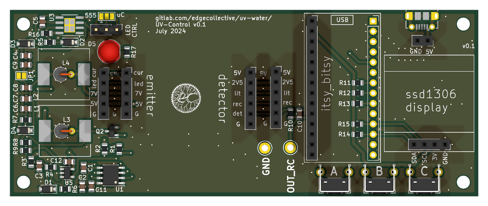
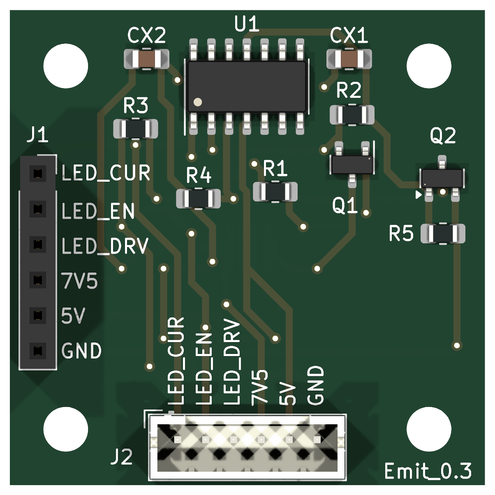
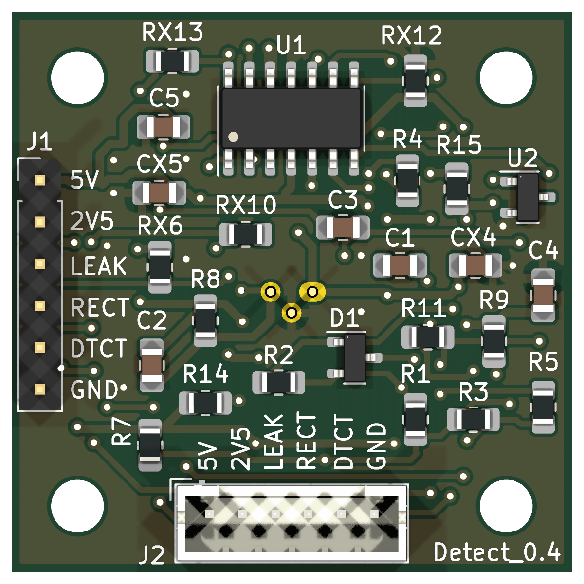

# uv254

Open hardware for the **uv254** UV water-quality sensor. The device is three
boards, each its own KiCad project:

| Board | Folder | What's on it | Current design |
|---|---|---|---|
| **UV-Control** | [`hardware/uv-control`](hardware/uv-control) | nRF52840 controller, ADS1115 ADC, color TFT, buttons, power | v0.4 (in progress: schematic draft) |
| **UV-Emitter** | [`hardware/uv-emitter`](hardware/uv-emitter) | Inolux IN-C35PPCTGU0 UV-C LED and its driver | v0.4 (released 2026-11-08) |
| **UV-Detector** | [`hardware/uv-detector`](hardware/uv-detector) | SD008-2171-112 photodiode with an op-amp front end | v0.4 (released 2026-11-08) |

| [UV-Control](hardware/uv-control) | [UV-Emitter](hardware/uv-emitter) | [UV-Detector](hardware/uv-detector) |
|:---:|:---:|:---:|
| <a href="hardware/uv-control"></a> | <a href="hardware/uv-emitter"></a> | <a href="hardware/uv-detector"></a> |

Each board's README has its schematic, PCB layout and 3D views.

UV-Emitter was called *UV-LED-source* in earlier revisions. Background notes
are at <https://edgecollective.io/notes/uvf/>.

## Repository layout

```
hardware/
  uv-control/                 one KiCad project per board
    uv-control.kicad_pro      open this in KiCad
    uv-control.kicad_sch
    uv-control.kicad_pcb
    sym-lib-table             -> lib/uv254.kicad_sym
    fp-lib-table              -> lib/uv254.pretty
    docs/                     schematic PDF and the images in the board's README
    fab/<version>/            fabrication files that were actually sent out
  uv-emitter/
  uv-detector/
lib/                          shared project library (custom parts only)
  uv254.kicad_sym
  uv254.pretty/
firmware/uv-control/          CircuitPython scripts for the control board
scripts/build-fab.sh          builds gerbers, drill, BOM, PDF, positions
scripts/render-images.sh      renders schematic, layout and 3D images for the READMEs
.github/workflows/kicad.yml   ERC/DRC on every push; fab package on release tags
```

## Opening the boards

**[Download the latest design files (zip)](https://github.com/edgecollective/uv254/archive/refs/heads/main.zip)** if you just want to look
at or build the boards, or clone the repository to work on them. Either way,
open `hardware/<board>/<board>.kicad_pro` in **KiCad 10.0.x**, the version
everyone on the project uses (see [CONTRIBUTING.md](CONTRIBUTING.md)).

Keep the folder structure as it is. Custom parts come from `lib/` through each
project's own library tables, so you don't need any global library setup beyond
KiCad's standard libraries, but a board folder copied out on its own will be
missing its custom parts.

## Updating the board images

Each board's README shows its schematic, PCB layout and 3D views. These are
files in `hardware/<board>/docs/`, made by `scripts/render-images.sh`, so they
don't change by themselves when the design does. After changing a board, save
it in KiCad, then refresh the images from the top of the repository:

```sh
scripts/render-images.sh uv-detector                         # one board
scripts/render-images.sh uv-control uv-detector uv-emitter   # all three
```

Then commit what changed (`git status` shows it) along with the design change.

What the script does:

- Writes to `hardware/<board>/docs/`: the schematic as PDF and PNG, the PCB
  layout front and back (the back mirrored, as seen from below), and 3D renders
  front and back.
- Updates the image section of the board's README, between the
  `render-images` markers. Anything you write between those markers gets
  overwritten, so put your own notes outside them.
- Only replaces files whose picture changed. A board whose 3D look changed
  takes about 2 minutes (two raytraced renders). An unchanged board takes about
  15 seconds and leaves git clean.
- Uses KiCad's default colour theme, so everyone's images come out the same
  whatever their own KiCad preferences.

For a quick look while you work, `--fast` makes flat-shaded 3D renders in a few
seconds. Commit the full renders, though: run it again without `--fast` before
committing.

It needs KiCad 10 (`kicad-cli` on your `PATH`), plus Inkscape, ImageMagick and
poppler. On Debian or Ubuntu:

```sh
sudo apt install inkscape imagemagick poppler-utils
```

It has only been tested on Linux.

## Versions and releases

Each board is versioned on its own. A revision is a git tag named
`<board>/<version>`:

```
git tag -l 'uv-detector/*'          # list detector revisions
git checkout uv-detector/v0.3       # the exact design ordered from JLCPCB in Aug 2024
git checkout main                   # back to the current work
```

To download one revision as a zip, use its tag, for example
<https://github.com/edgecollective/uv254/archive/refs/tags/uv-detector/v0.3.zip>.

`hardware/<board>/fab/<version>/` holds the files that were actually sent to
the fab house for that revision. Each board's README has the revision history.
Pushing a new tag makes CI build that board's fab package and attach it to a
GitHub Release (see [CONTRIBUTING.md](CONTRIBUTING.md#releasing-a-board-revision)).

The history before this repository is in
[gitlab.com/edgecollective/uv-water](https://gitlab.com/edgecollective/uv-water).
Every tagged revision here was imported from it. The imported fab files were
checked by regenerating them from the tagged design.

## License

- **Hardware** (everything except `firmware/`): [CERN Open Hardware Licence
  Version 2 – Strongly Reciprocal](LICENSE) (CERN-OHL-S-2.0).
- **Firmware** (`firmware/`): [MIT License](firmware/uv-control/LICENSE). The
  bundled Adafruit libraries are also MIT, under Adafruit's copyright.

Contributors: Don Blair, Craig Versek.
