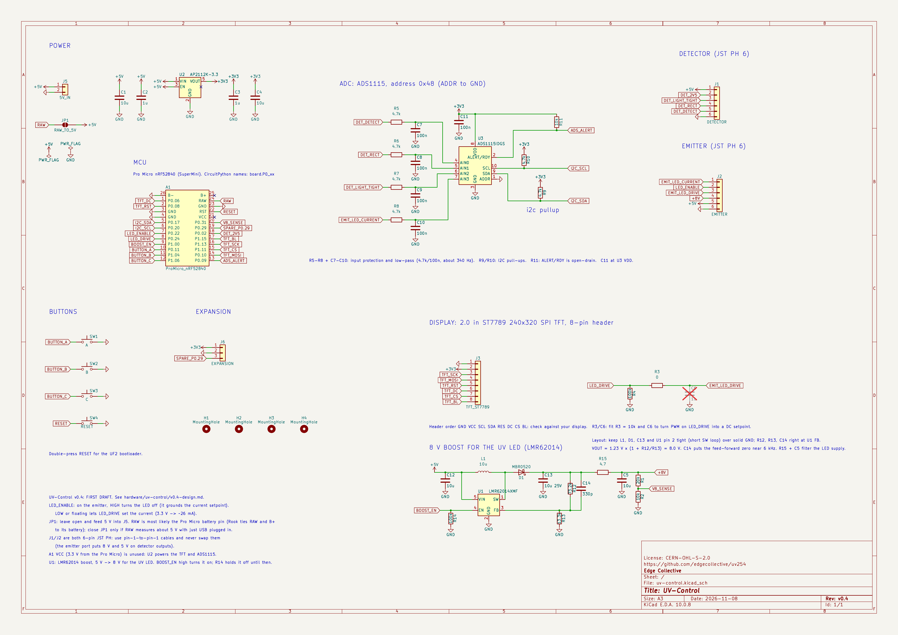
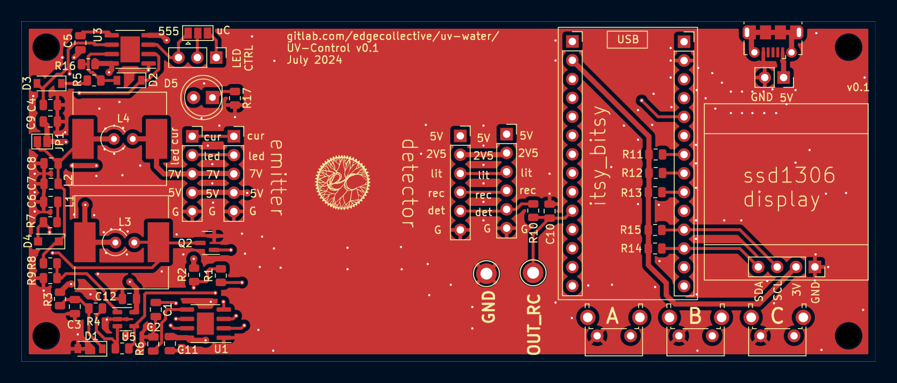
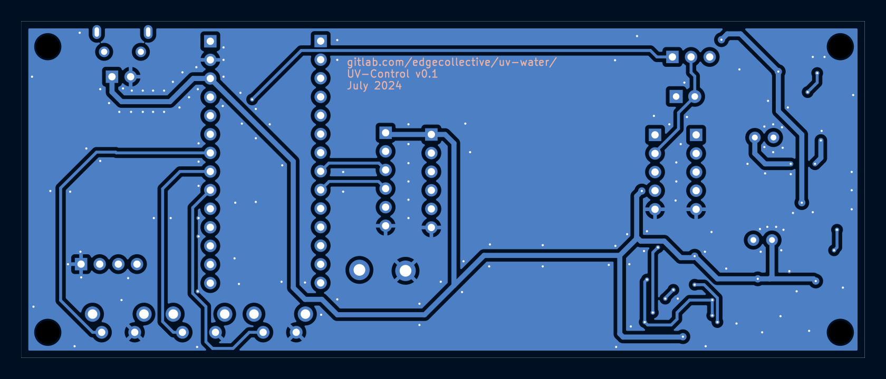
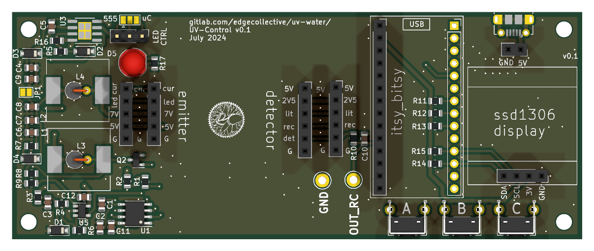
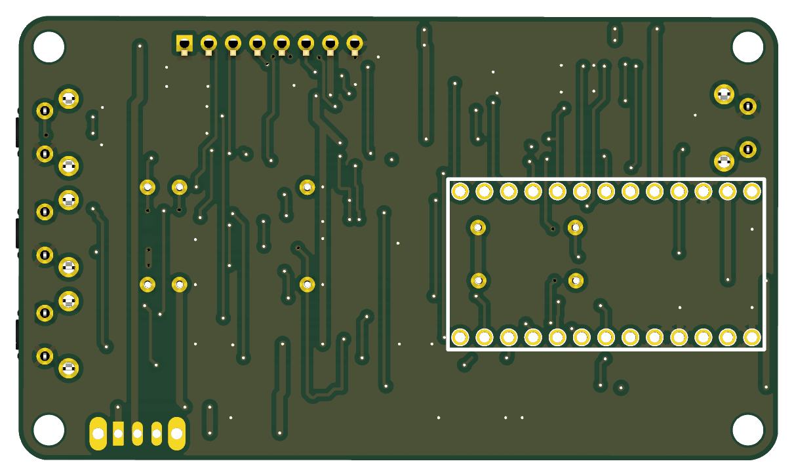

# UV-Control

Controller board: an Adafruit ItsyBitsy nRF52840 Express, an SSD1306 OLED
display, push buttons and power circuitry. Firmware is in
[`firmware/uv-control`](../../firmware/uv-control).

Open `uv-control.kicad_pro` in KiCad 10. Custom parts come from
[`lib/`](../../lib).

**[Download the KiCad files (zip)](https://github.com/edgecollective/uv254/archive/refs/heads/main.zip)**: the whole repository as it is on
`main`, because the board needs the shared `lib/` folder. This board is in
`hardware/uv-control/`.

<!-- render-images:start -->
<!-- Generated by scripts/render-images.sh. Edits between these markers are overwritten. -->

## Schematic

Click the image for the [PDF](docs/uv-control-schematic.pdf).

## Board layout

Copper and silkscreen. The back is mirrored, as seen from below.

| Front | Back |
|:---:|:---:|
|  |  |

## 3D view

| Front | Back |
|:---:|:---:|
|  |  |

Images of the current design, made with `scripts/render-images.sh uv-control`.
Re-run it after changing the board; see
[Updating the board images](../../README.md#updating-the-board-images).
<!-- render-images:end -->

## Revisions

| Version | Date | Status | Design | Fab files |
|---|---|---|---|---|
| v0.1 | 2024-07-29 | gerbers released; ordered from JLCPCB on 2024-08-19 | tag `uv-control/v0.1` | [`fab/v0.1`](fab/v0.1) |
| v0.1_A | 2026-06-26 | branched from v0.1; sent to Josh | tag `uv-control/v0.1_A` | — |
| **next** | 2026-10 | **on `main`**: board edits made after v0.1_A was sent, untagged | `main` | — |

Notes:

- The silkscreen still points to `gitlab.com/edgecollective/uv-water/` and
  reads `UV-Control v0.1 / July 2024`. Update both before the next fabrication.
