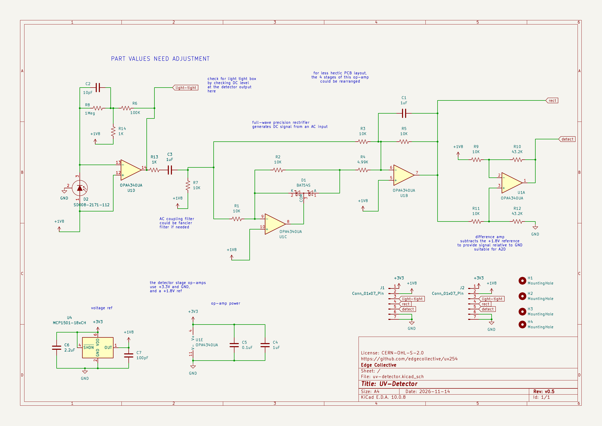
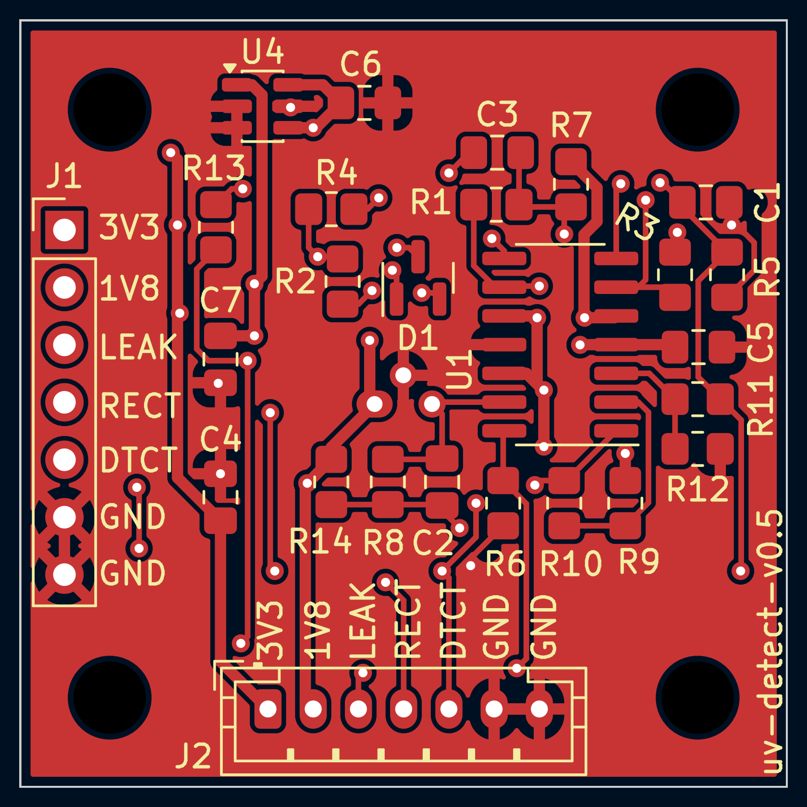
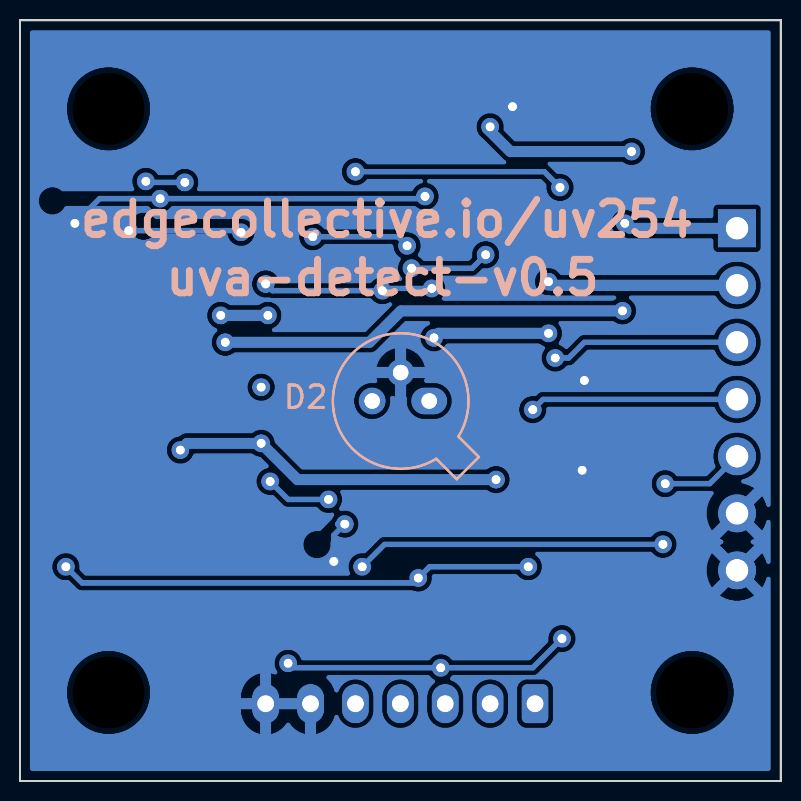
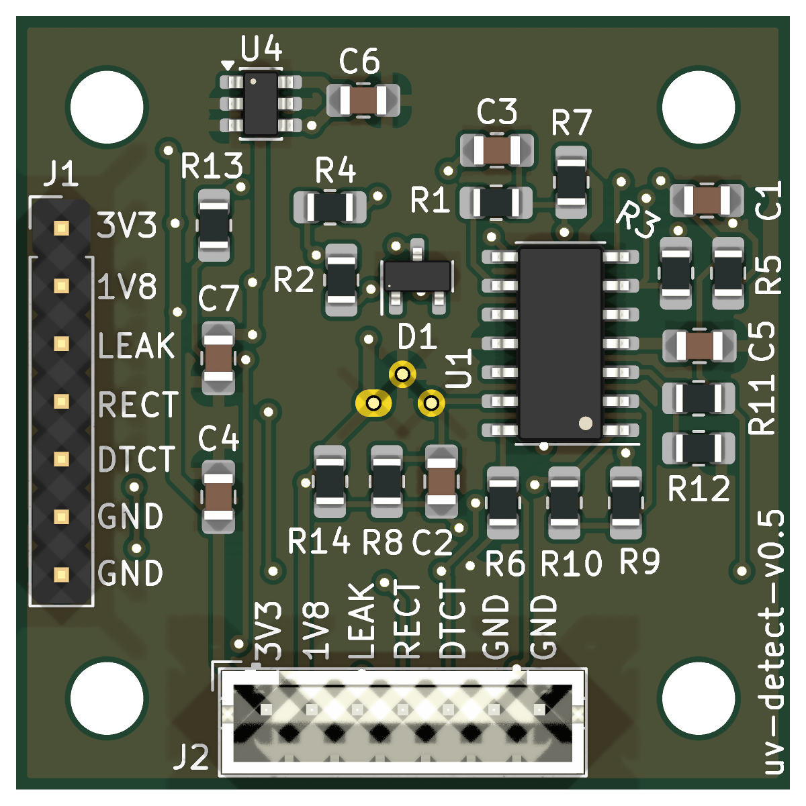
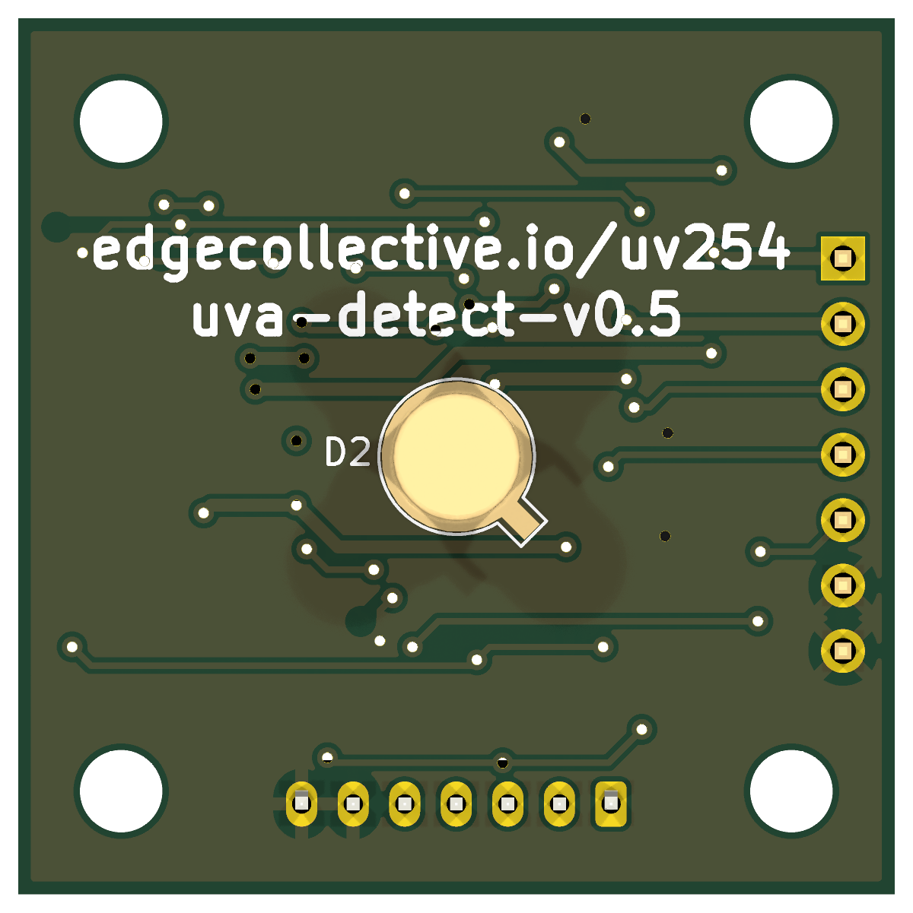

# UV-Detector

Photodiode board: an SD008-2171-112 photodiode with an OPA4340 op-amp front
end. From v0.5 it runs from 3.3 V, with an MCP1501-18 1.8 V reference.

The cable connector is a 7-pin JST PH (J2), with a 0.1" header (J1) in
parallel:

| Pin | 1 | 2 | 3 | 4 | 5 | 6 | 7 |
|---|---|---|---|---|---|---|---|
| Signal | 3V3 | 1V8 (reference out) | light-tight (`LEAK`) | rect (`RECT`) | detect (`DTCT`) | GND | GND |

Open `uv-detector.kicad_pro` in KiCad 10. Custom parts come from
[`lib/`](../../lib).

**[Download the KiCad files (zip)](https://github.com/edgecollective/uv254/archive/refs/heads/main.zip)**: the whole repository as it is on
`main`, because the board needs the shared `lib/` folder. This board is in
`hardware/uv-detector/`.

<!-- render-images:start -->
<!-- Generated by scripts/render-images.sh. Edits between these markers are overwritten. -->

## Schematic

Click the image for the [PDF](docs/uv-detector-schematic.pdf).

## Board layout

Copper and silkscreen. The back is mirrored, as seen from below.

| Front | Back |
|:---:|:---:|
|  |  |

## 3D view

| Front | Back |
|:---:|:---:|
|  |  |

Images of the current design, made with `scripts/render-images.sh uv-detector`.
Re-run it after changing the board; see
[Updating the board images](../../README.md#updating-the-board-images).
<!-- render-images:end -->

## Revisions

| Version | Date | Status | Design | Fab files |
|---|---|---|---|---|
| v0.1 | 2024-03-12 | gerbers released | tag `uv-detector/v0.1` | [`fab/v0.1`](fab/v0.1) |
| v0.2 | 2024-04-06 | gerbers released | tag `uv-detector/v0.2` | [`fab/v0.2`](fab/v0.2) |
| v0.3 | 2024-08-19 | ordered from JLCPCB with emitter v0.3 and control v0.1 | tag `uv-detector/v0.3` | [`fab/v0.3`](fab/v0.3) |
| v0.2_A | 2026-06-26 | branched from v0.2; sent to Josh | tag `uv-detector/v0.2_A` | — |
| v0.2_B | 2026-10 | follows v0.2_A | tag `uv-detector/v0.2_B` | — |
| **v0.4** | 2026-11-08 | **gerbers released**; derived from v0.2_B | tag `uv-detector/v0.4` | [`fab/v0.4`](fab/v0.4) |
| v0.5 | — | in progress on `main` | `main` | — |

Notes:

- **v0.2**: the fabricated gerbers also include the copper text
  `uva-detect-v0.2` on F.Cu. It was deleted from the board before the design
  was committed. See [`fab/v0.2/README.md`](fab/v0.2/README.md).
- **v0.3** has no `.kicad_pro`, because it was never committed upstream. Open
  `uv-detector.kicad_pcb` or `.kicad_sch` directly at that tag.
- **v0.4** was called "v0.3" in `uv-water`. It was renumbered because v0.3 was
  already used by the 2024 JLCPCB order.
- **v0.5** (in progress) moves to the system-wide 3.3 V supply: the op-amp runs
  from 3.3 V instead of 5 V, and an MCP1501-18 (1.8 V, buffered) replaces the
  LM4040 2.5 V shunt reference and its feed resistor. The connectors grow from
  6 to 7 pins, the extra pin being a second GND. Signal swing above the
  reference drops from 2.5 V to 1.5 V, so the gain values may need adjusting.
