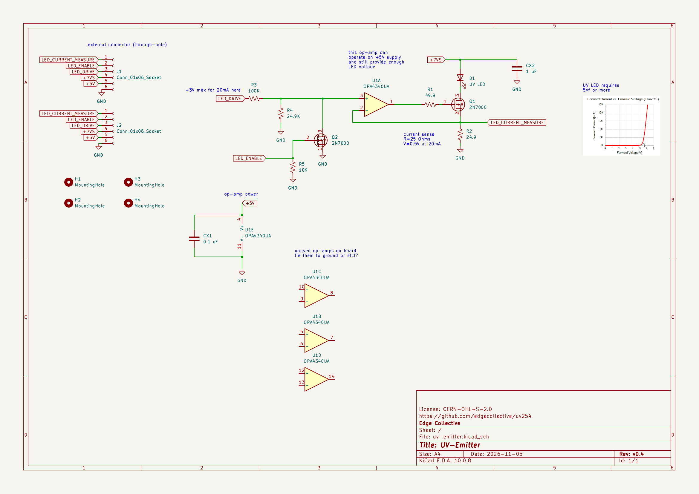
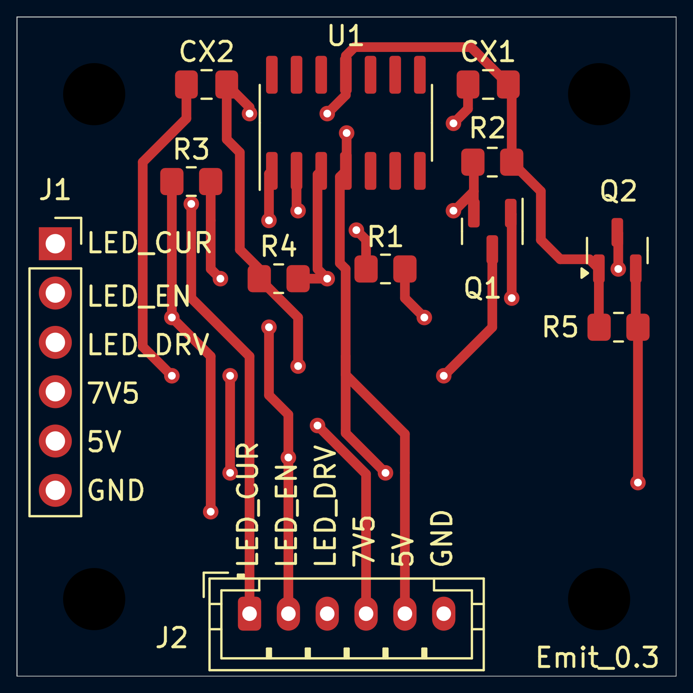
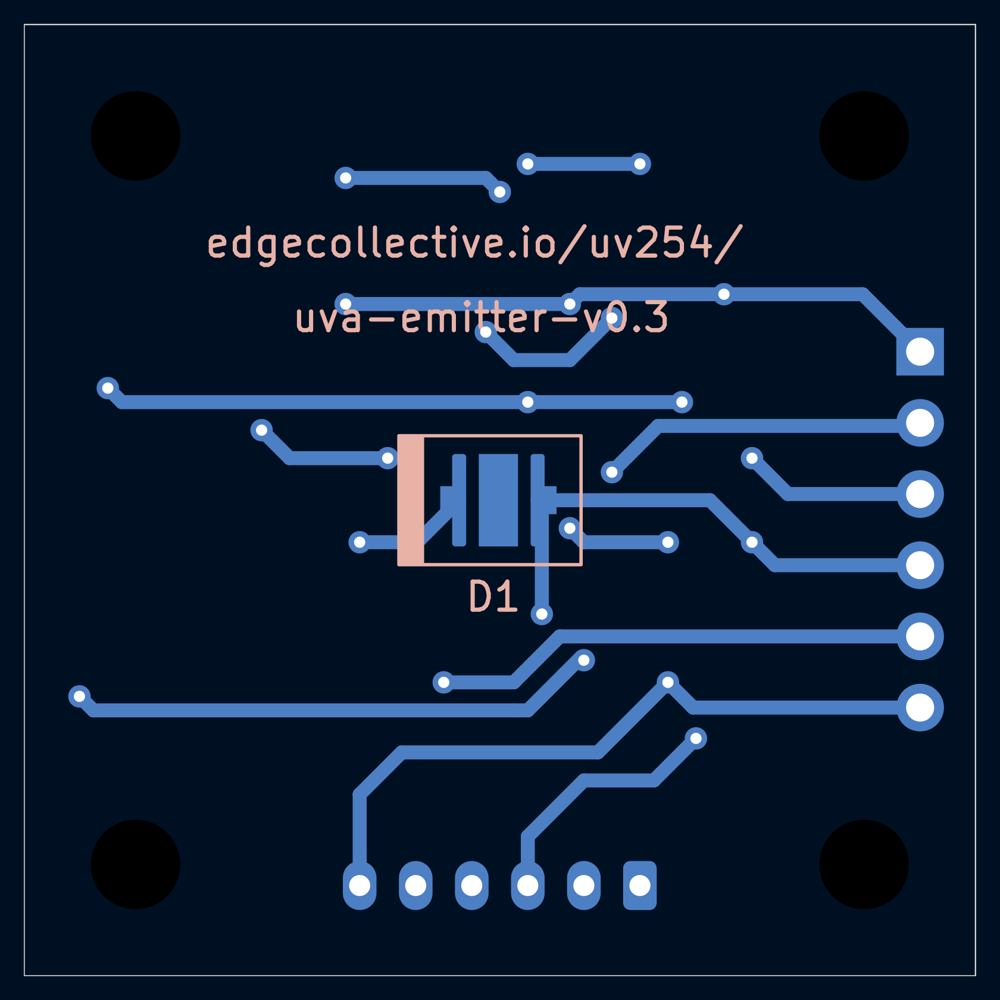
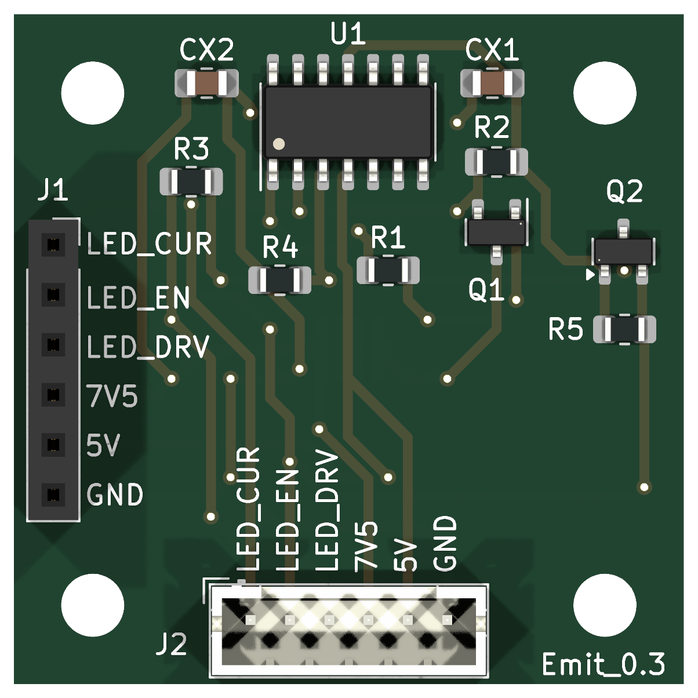
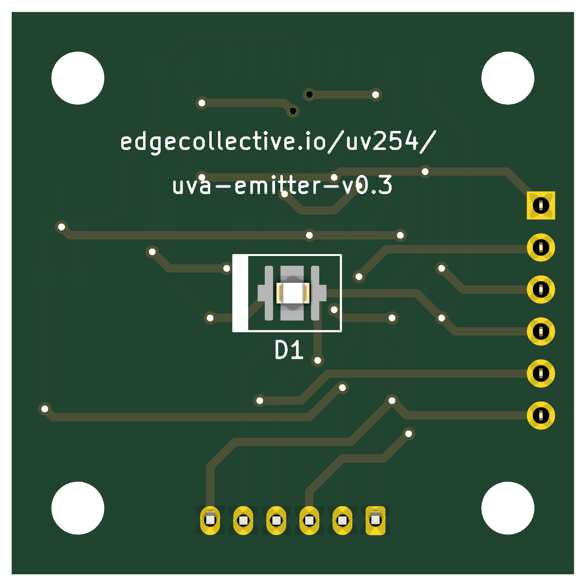

# UV-Emitter

UV LED board: an Inolux IN-C35PPCTGU0 UV-C LED with its driver circuit.
Called **UV-LED-source** in the `uv-water` repository.

Open `uv-emitter.kicad_pro` in KiCad 10. Custom parts come from
[`lib/`](../../lib).

<!-- render-images:start -->
<!-- Generated by scripts/render-images.sh. Edits between these markers are overwritten. -->

## Schematic

Click the image for the [PDF](docs/uv-emitter-schematic.pdf).

## Board layout

Copper and silkscreen. The back is mirrored, as seen from below.

| Front | Back |
|:---:|:---:|
|  |  |

## 3D view

| Front | Back |
|:---:|:---:|
|  |  |

Images of the current design, made with `scripts/render-images.sh uv-emitter`.
Re-run it after changing the board.
<!-- render-images:end -->

## Revisions

| Version | Date | Status | Design | Fab files |
|---|---|---|---|---|
| v0.1 | 2024-03-11 | gerbers released | tag `uv-emitter/v0.1` | [`fab/v0.1`](fab/v0.1) |
| v0.2 | 2024-04-06 | gerbers released | tag `uv-emitter/v0.2` | [`fab/v0.2`](fab/v0.2) |
| v0.3 | 2024-08-19 | ordered from JLCPCB with detector v0.3 and control v0.1 | tag `uv-emitter/v0.3` | [`fab/v0.3`](fab/v0.3) |
| v0.2_A | 2026-06 to 2026-10 | design revision branched from v0.2, not fabricated | tag `uv-emitter/v0.2_A` | — |
| **v0.4** | 2026-11 | **in progress on `main`**, derived from v0.2_A | `main` | — |

Notes:

- **v0.3** has no `.kicad_pro`, because it was never committed upstream. Open
  `uv-emitter.kicad_pcb` or `.kicad_sch` directly at that tag.
- **v0.4** was called "v0.3" in `uv-water`. It was renumbered because v0.3 was
  already used by the 2024 JLCPCB order. Its silkscreen still reads
  `uva-emitter-v0.3`, so update it before fabrication.
