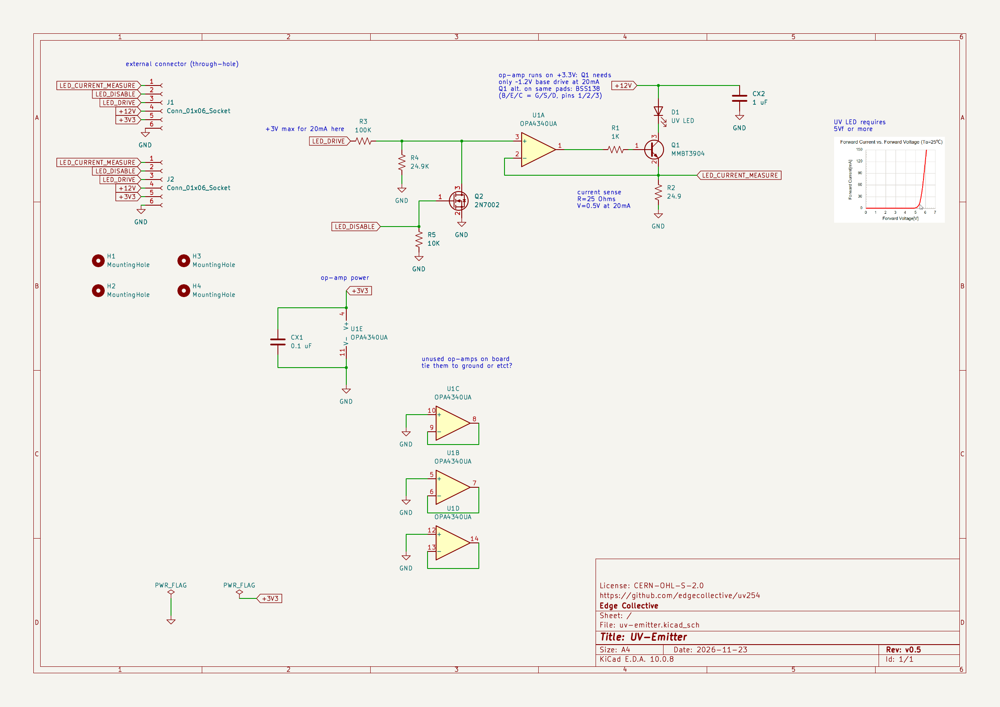
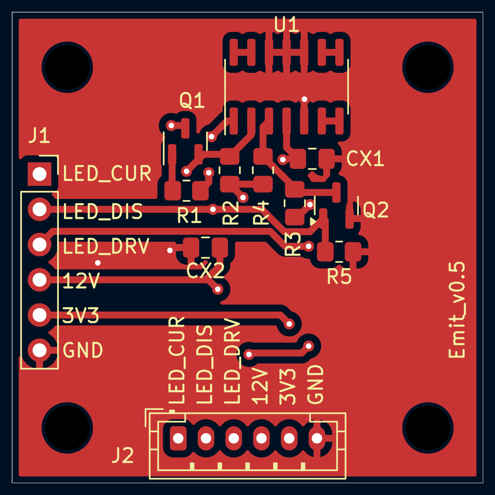
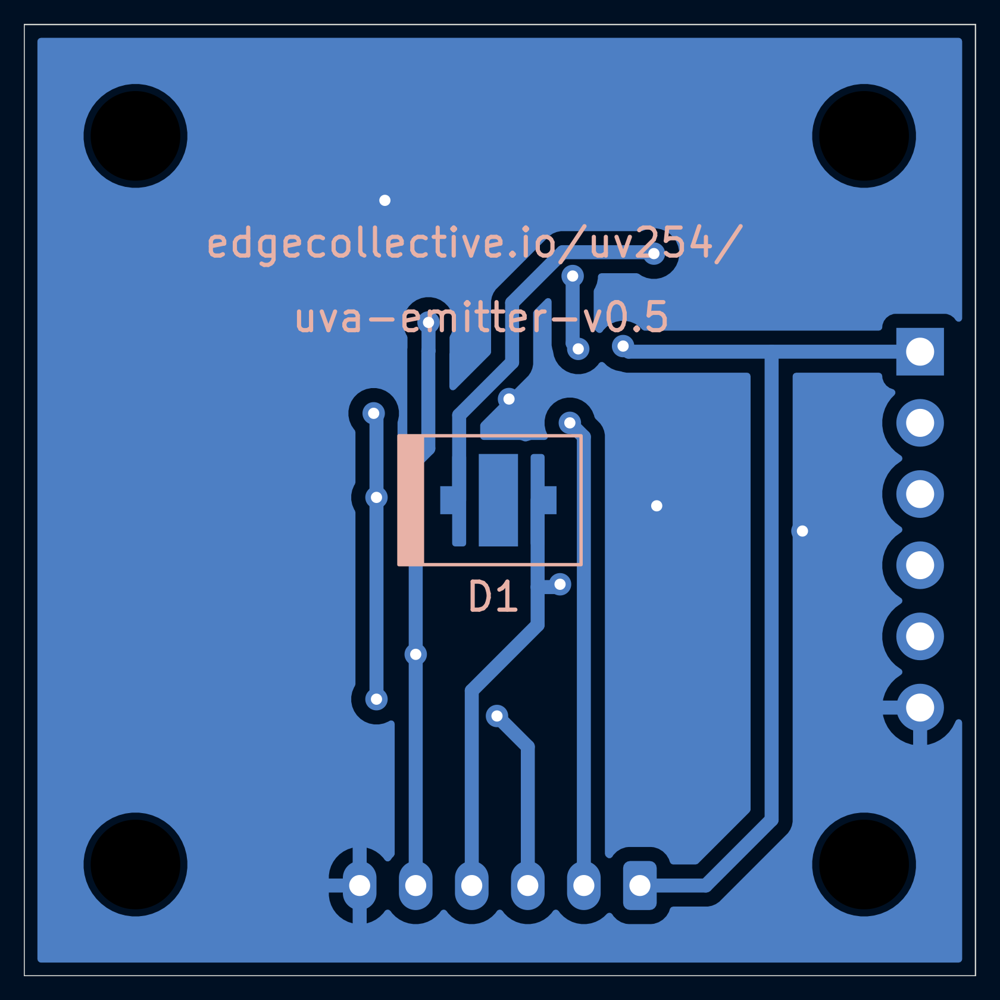
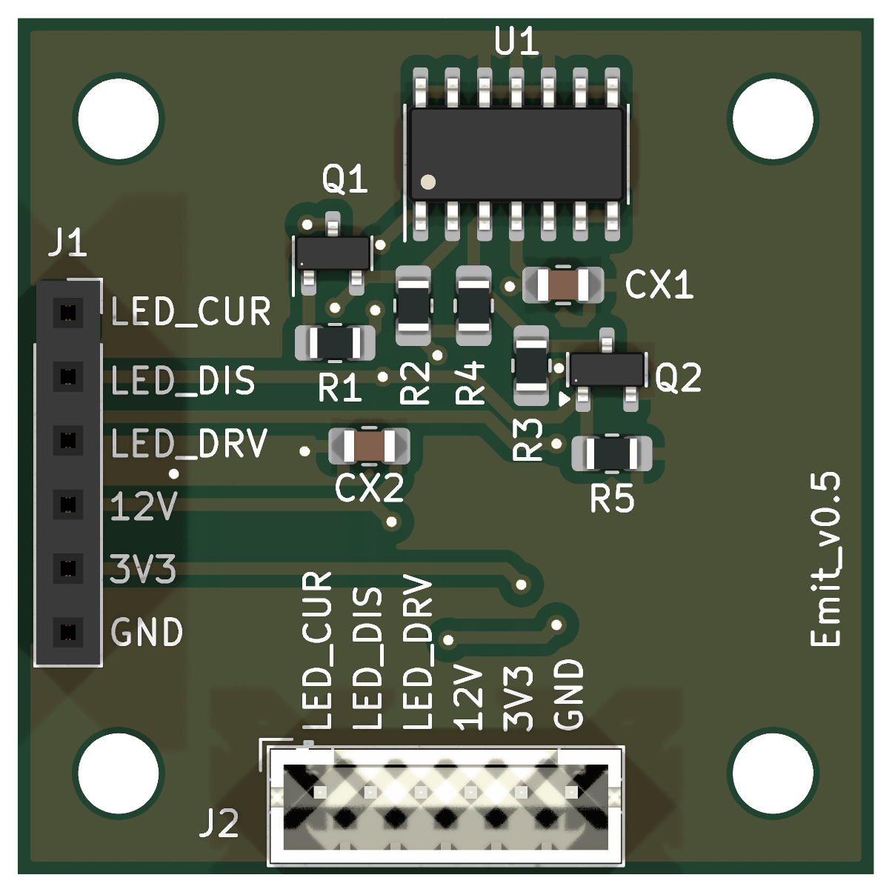
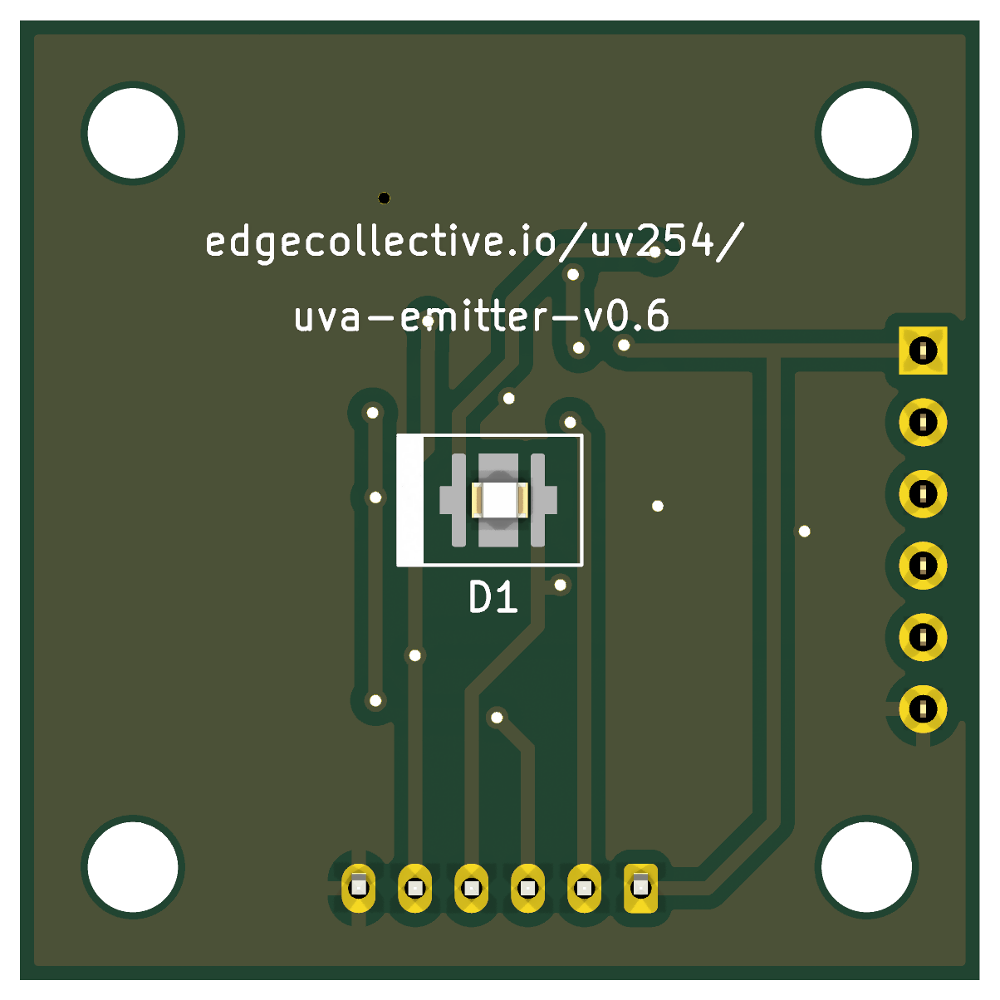

# UV-Emitter

UV LED board: an Inolux IN-C35PPCTGU0 UV-C LED with its driver circuit.
Called **UV-LED-source** in the `uv-water` repository.

The driver is a current sink: an OPA4340 op-amp drives Q1 so that the
voltage across R2 (24.9 Ω) matches LED_DRIVE divided down by R3/R4 (100k/24.9k):
3.3 V on LED_DRIVE gives about 26 mA, and 2.5 V about 20 mA. From v0.5 the op-amp runs from 3.3 V, Q1 is an
MMBT3904 (a BSS138 fits the same pads), and the LED has its own 12 V supply.

The cable connector is a 6-pin JST PH (J2), with a 0.1" socket (J1) in
parallel:

| Pin | 1 | 2 | 3 | 4 | 5 | 6 |
|---|---|---|---|---|---|---|
| Signal | LED_CURRENT_MEASURE (`LED_CUR`) | LED_DISABLE (`LED_DIS`) | LED_DRIVE (`LED_DRV`) | +12V (LED supply) | 3V3 | GND |

LED_DISABLE high turns the LED off (Q2 grounds the setpoint). LED_CURRENT_MEASURE
is the voltage across R2: 0.5 V at 20 mA.

Open `uv-emitter.kicad_pro` in KiCad 10. Custom parts come from
[`lib/`](../../lib).

**[Download the KiCad files (zip)](https://github.com/edgecollective/uv254/archive/refs/heads/main.zip)**: the whole repository as it is on
`main`, because the board needs the shared `lib/` folder. This board is in
`hardware/uv-emitter/`.

<!-- render-images:start -->
<!-- Generated by scripts/render-images.sh. Edits between these markers are overwritten. -->

## Schematic

Click the image for the [PDF](docs/uv-emitter-schematic.pdf).

## Board layout

Copper and silkscreen. The back is mirrored, as seen from below.

| Front | Back |
|:---:|:---:|
|  |  |

## 3D view

| Front | Back |
|:---:|:---:|
|  |  |

Images of the current design, made with `scripts/render-images.sh uv-emitter`.
Re-run it after changing the board; see
[Updating the board images](../../README.md#updating-the-board-images).
<!-- render-images:end -->

## Revisions

| Version | Date | Status | Design | Fab files |
|---|---|---|---|---|
| v0.1 | 2024-03-11 | gerbers released | tag `uv-emitter/v0.1` | [`fab/v0.1`](fab/v0.1) |
| v0.2 | 2024-04-06 | gerbers released | tag `uv-emitter/v0.2` | [`fab/v0.2`](fab/v0.2) |
| v0.3 | 2024-08-19 | ordered from JLCPCB with detector v0.3 and control v0.1 | tag `uv-emitter/v0.3` | [`fab/v0.3`](fab/v0.3) |
| v0.2_A | 2026-06 to 2026-10 | design revision branched from v0.2, not fabricated | tag `uv-emitter/v0.2_A` | — |
| v0.4 | 2026-11-08 | gerbers released; derived from v0.2_A (5 V, 7 V LED supply, LED_ENABLE) | tag `uv-emitter/v0.4` | [`fab/v0.4`](fab/v0.4) |
| v0.5 | 2026-11-23 | gerbers released, then renumbered v0.6 with the set before ordering (same design) | tag `uv-emitter/v0.5` | [`fab/v0.5`](fab/v0.5) |
| **v0.6** | 2026-11-23 | **gerbers released**: 3.3 V, 12 V LED supply, MMBT3904 driver, LED_DISABLE; for UV-Control v0.6 | tag `uv-emitter/v0.6` | [`fab/v0.6`](fab/v0.6) |

Notes:

- **v0.3** has no `.kicad_pro`, because it was never committed upstream. Open
  `uv-emitter.kicad_pcb` or `.kicad_sch` directly at that tag.
- **v0.4** was called "v0.3" in `uv-water`. It was renumbered because v0.3 was
  already used by the 2024 JLCPCB order.
- **v0.4 has a pinout error on Q2**, the LED-disable switch. Its symbol was the
  through-hole 2N7000 (pin 1 source, 2 gate, 3 drain) on a SOT-23 footprint,
  where a 2N7002 or BSS138 has pin 1 gate, 2 source, 3 drain. With a SOT-23
  MOSFET fitted, Q2's gate is held at GND and LED_ENABLE drives its source: the
  LED can't be turned off that way, and driving LED_ENABLE high makes Q2's body
  diode conduct, raising the setpoint to about 2.7 V, which asks for about
  100 mA instead of 20 mA. On v0.4 boards, leave Q2 unfitted (or keep
  LED_ENABLE low) and turn the LED off with LED_DRIVE = 0. Fixed in v0.5.
- **v0.5** (in progress) moves to the system-wide 3.3 V supply:
  - op-amp supply 3.3 V instead of 5 V (connector pin 5); the LED gets its own
    12 V supply on pin 4 instead of 7.5 V, for more headroom over the LED's
    forward voltage
  - Q1 is an MMBT3904 NPN with a 1 kΩ base resistor (R1, was a 2N7002-type
    MOSFET with 49.9 Ω), so the 3.3 V op-amp has plenty of drive; a BSS138 fits
    the same pads
  - Q2 uses the 2N7002 symbol, which fixes the v0.4 pinout error
  - LED_ENABLE renamed LED_DISABLE, since high turns the LED off (behaviour
    unchanged)
  - board re-laid out
